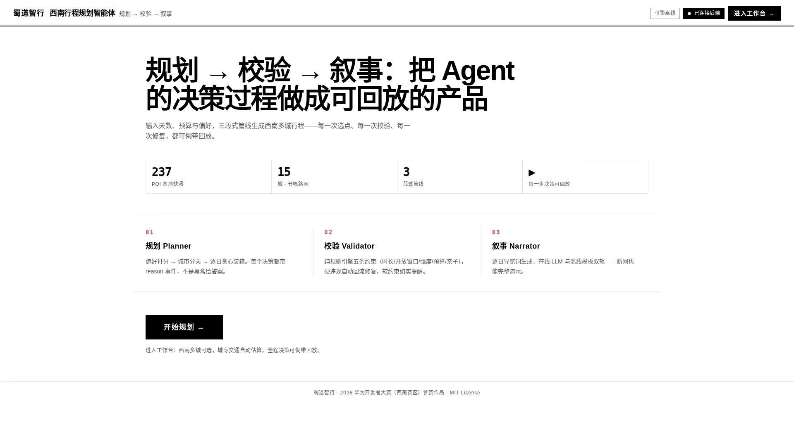
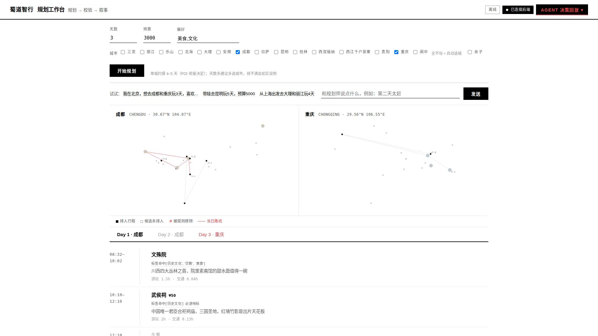
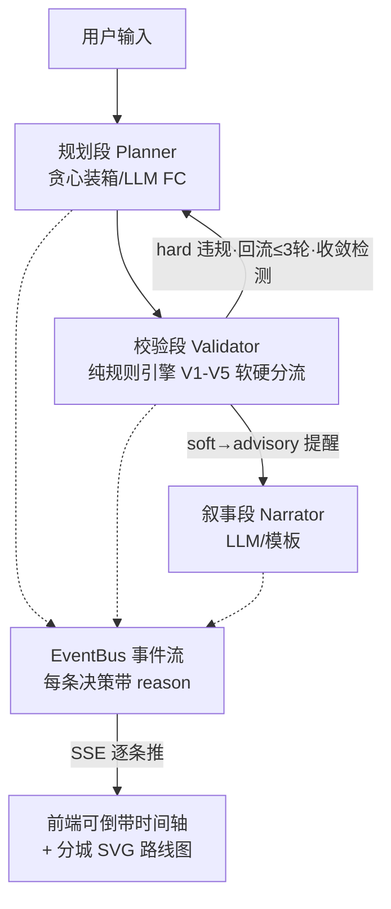
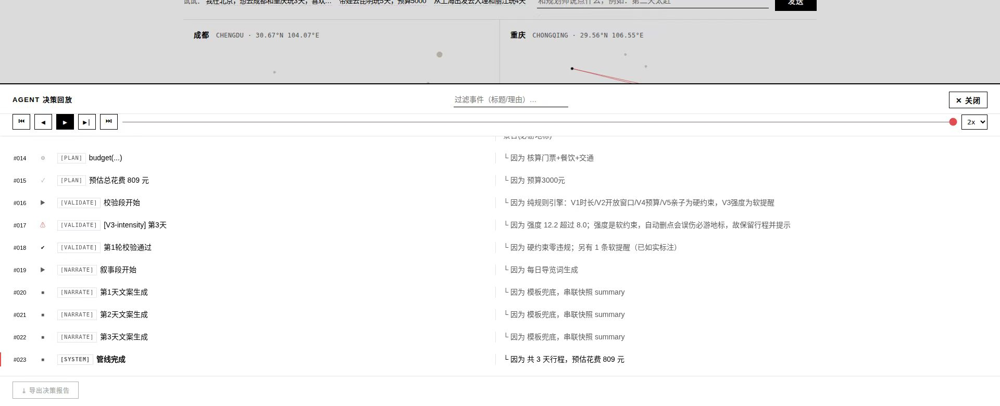
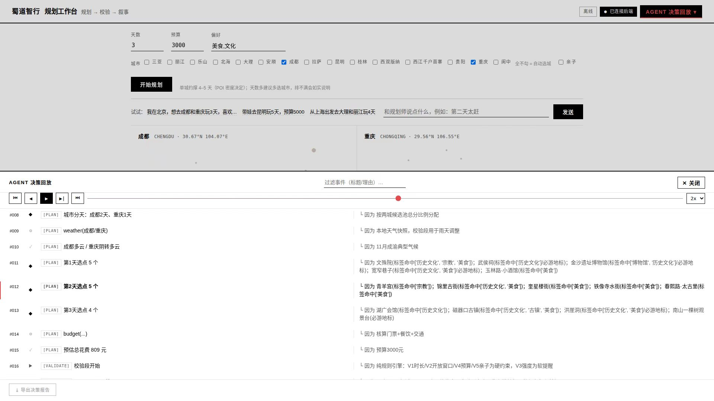
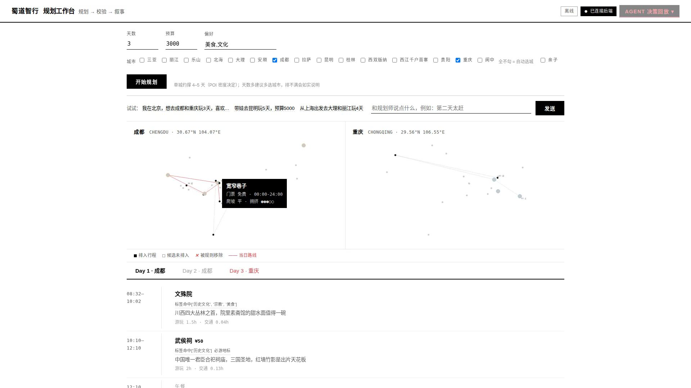
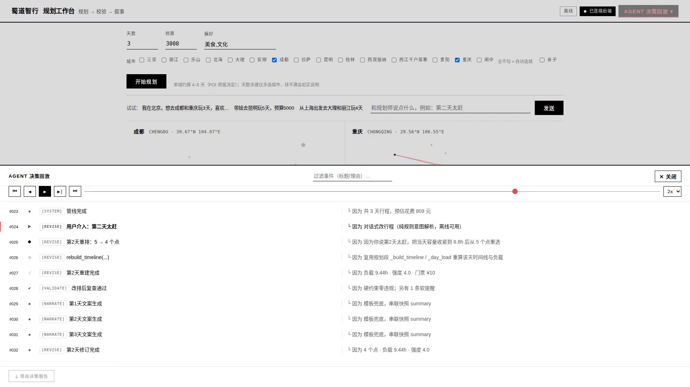

# 蜀道智行 · 西南行程规划智能体

> **规划 → 校验 → 叙事** 三段式管线，把 Agent 的决策过程做成**可回放的产品**。

    

> 2026 华为开发者大赛·智能体创新赛（西南赛区）参赛作品。



## 它解决什么问题

行程规划 Agent 的通病是「黑盒给答案」：用户只看到最终行程，看不到**为什么**。
蜀道智行把三段式管线的每一次选点、每一次校验、每一次修复都做成带 `reason` 的结构化事件——
前端可以**倒带回放**到任何一步，看它当时怎么想的。



## 快速开始（四种运行方式）

```bash
# ① CLI（断网保命形态，仅标准库零依赖）
python cli.py --days 3 --budget 3000 --tags 美食,文化

# ② Web 服务（API + SSE + 前端一条命令）
python scripts/ctl.py serve
# 品牌首页 http://localhost:8000/ → 「进入工作台」进规划台
# 规划工作台 http://localhost:8000/plan.html?days=3&budget=3000&tags=美食,文化&auto=1

# ③ 纯静态演示（后端不起，前端自动切本地演示数据）
python -m http.server 8765 --directory static

# ④ 开发自检（ruff + pytest + 前端冒烟）
python scripts/ctl.py ci
```

URL 参数预置：`?days=&budget=&tags=&family=1&cities=成都,重庆&auto=1`——录视频/答辩免现场输入
（带参数的旧链接打到首页会自动透传到工作台 `plan.html`）。

## 系统架构



详见 `docs/架构设计.md`（含 ASCII 版与前端模块数据流）。

## 核心功能









| 功能 | 说明 |
|---|---|
| 可倒带决策时间轴 | 拖进度条回到任何一步：地图点位/行程卡同步回退，`reason` 列解释「为什么」 |
| 分城 SVG 自绘路线图 | 西南多城分城投影、朱红当日路线、修复移除点灰叉标注 |
| 对话式改行程 | 「第二天太赶」→ 规则意图解析 → 只重排目标天，第二幕事件可回放 |
| 事件回放到中段 | 进度条拖到任意位置，地图与行程卡同步回到那一刻的状态 |
| 断网兜底 | 后端缺席自动切本地演示数据（徽标如实标注），演示永不中断 |

图片资产规格见 `docs/images/README.md`（拍摄模式 `?shot=` 直达各状态，录屏与截图同源）。

## 规则引擎一览

| 规则 | severity | 判定 | 修复 |
|---|---|---|---|
| V1 时长 | hard | 内容时长 ≤ 容量 11.0h（跨城 9.2h），收班 ≤ 22:00 | 摘点回流 |
| V2 开放窗口 | hard | 到离时间落在 open_hour 内 | 移除回流 |
| V3 强度 | **soft** | Σ(slope+crowd×0.4) ≤ 城市地形分档阈值（盆地 8.5 / 丘陵 8.0 / 喀斯特 7.5 / 高原 7.0 / 极高海拔 6.0） | 不自动修复，advisory 提醒 |
| V4 预算 | hard | 总花费 ≤ 用户预算 | 摘高价点回流 |
| V5 亲子 | hard | family ≥ 2 | 移除回流 |

完整规格（容量口径不变量/摘点排序键/收敛检测/真实 CLI 示例）：`docs/规则引擎规格.md`。

## 数据说明

西南 15 城总表 + 15 城 237 点本地快照（深度层 6 城 + 广度层 9 城，批次1/2/3 全部落地；
数据核对状态见 `server/data/schema.md`），
**分城文件 + meta.json 数据层**——新增城市零代码改动。
厚字段（开放时段/预约难度/人流高峰/爬坡强度/亲子友好度/夜间体验）即决策依据；
V3 强度阈值按城市地形分档（盆地/丘陵/喀斯特/高原/极高海拔），城际交通按枢纽距离自动生成。
字段规范见 `server/data/schema.md`。

## 演示视频

待录制（3 分钟逐镜头分镜：`docs/演示脚本.md`；PPT 分镜：`ppt/` 由 Prompt 05 产出）。

## 文档索引

| 文档 | 内容 |
|---|---|
| `docs/架构设计.md` | 三段式管线 + 事件流时序 + 关键设计决策 |
| `docs/规则引擎规格.md` | V1–V5 完整规格（最值钱的一份） |
| `docs/API.md` | 六端点契约 + SSE 帧格式 + 事件枚举 |
| `docs/华为云接入说明.md` | OBS / FunctionGraph / CodeArts 三条可选接入线 |
| `docs/开发指南.md` | 新增城市 / 新增规则 / 新增事件类型 |
| `docs/演示脚本.md` | 3 分钟视频逐镜头表 |
| `docs/赛题情报/` | 大赛官网抓取的赛题与评分标准**原文**（原始抓取存档在 `不上交/`，不进 zip） |
| `readme/README.md` | 赛题提交四条说明（含码道应用总结） |

## 团队分工

见 `readme/团队分工.md`（已按报名队伍信息填入 4 名成员姓名与分工）。
**队伍名称**：网恋被骗五毛钱 ｜ **本人专业**：人工智能技术应用 ｜ **联系人**：刘明超

## 提交

提交包结构、哪些文件上交/不上交、提交前三道机器闸，全部写在
[`提交清单.md`](提交清单.md)。

## 许可

MIT（见 `LICENSE`，署名行待填队伍名）。