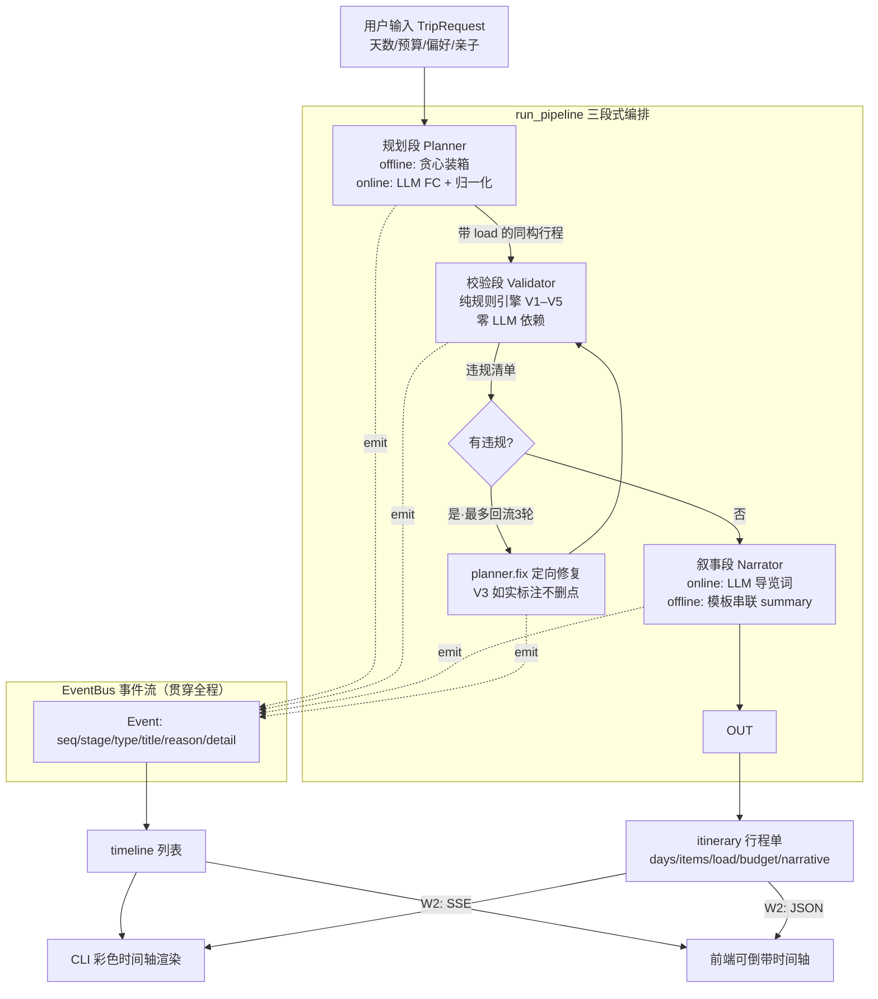
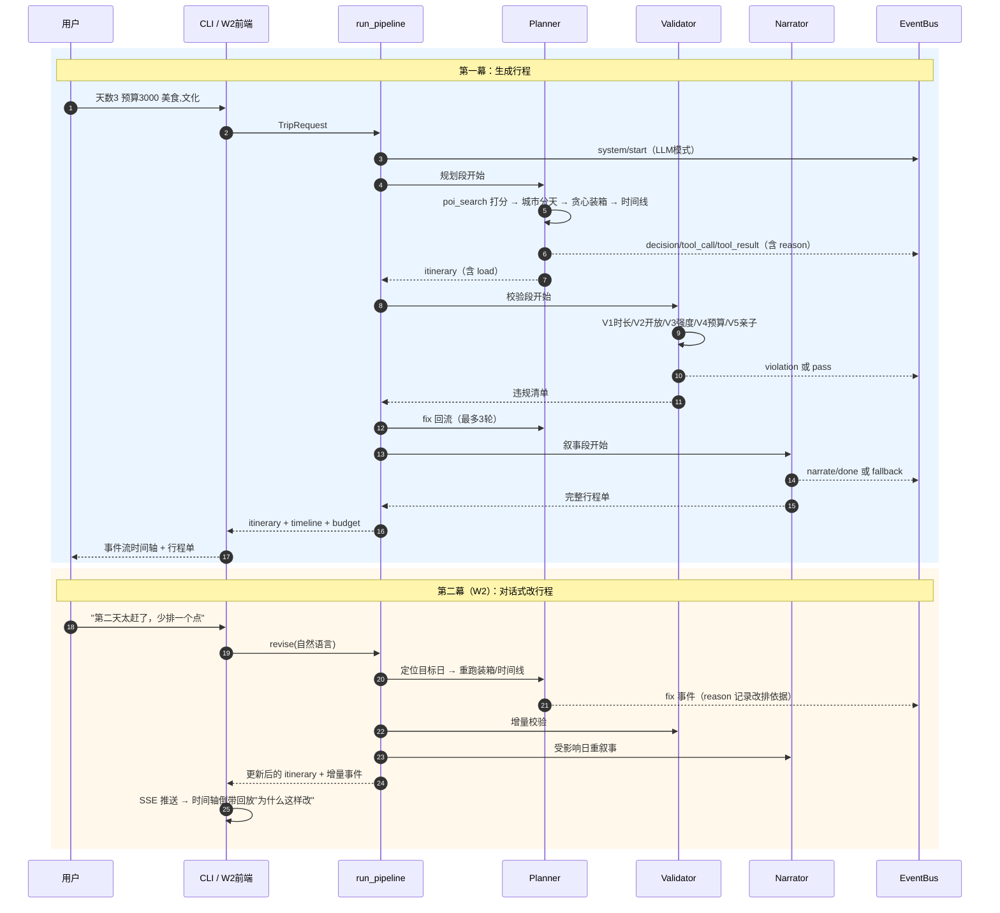

# 架构说明（architecture.md）

# 生成于 2026-10-28 23:42:00，命令：人工编写（架构事实取自 server/agent/*.py 与 cli.py 源码静态阅读）

## 一、三段式管线总览（mermaid flowchart）



## 二、交互时序（mermaid sequenceDiagram）



## 三、ASCII 版架构图

```
                      ┌─────────────────────────────────────────────┐
   TripRequest ──────►│  run_pipeline（server/agent/pipeline.py）    │
   days/budget/       │                                             │
   tags/family        │  ┌─────────┐   ┌──────────┐   ┌─────────┐  │
                      │  │ Planner │──►│Validator │──►│Narrator │  │
                      │  │ 规划段  │   │ 校验段    │   │ 叙事段  │  │
                      │  │         │◄──┤ 规则引擎  │   │         │  │
                      │  │贪心装箱  │fix│ V1..V5   │   │LLM/模板 │  │
                      │  │LLM FC   │   │ (零LLM)  │   │         │  │
                      │  └────┬────┘   └────┬─────┘   └────┬────┘  │
                      │       │   ↺回流≤3轮 │              │       │
                      └───────┼─────────────┼──────────────┼───────┘
                              │  emit       │ emit         │ emit
                              ▼             ▼              ▼
                      ┌─────────────────────────────────────────────┐
                      │  EventBus（server/agent/events.py）          │
                      │  Event{seq,stage,type,title,reason,detail}  │
                      │  实例级seq · 进程级t单调                     │
                      └──────────────────┬──────────────────────────┘
                                         │ timeline()
              ┌──────────────────────────┼──────────────────────────┐
              ▼                          ▼                          ▼
      CLI 彩色时间轴             W2: SSE 事件流              W2: 可倒带时间轴
      (cli.py TYPE_MARK)        (逐事件推送)          (GSAP timeline seek/label)
```

## 四、事件流字段说明（数据源：server/agent/events.py + cli.py）

| 字段 | 类型 | 含义 |
|---|---|---|
| `seq` | int | 实例内事件序号，从 1 起（EventBus 实例化时重置，多管线互不串号） |
| `t` | float | 距进程时间基准 `_t0` 的秒数（模块级基准，跨实例单调不减；仅在 `timeline()` 中不输出，`to_dict()` 含） |
| `stage` | str | 所属管线阶段，取值见下表 |
| `type` | str | 事件类型，取值见下表 |
| `title` | str | 事件标题（人类可读，直接渲染在时间轴上） |
| `reason` | str | **决策依据——可倒带回放的核心字段**，回答「为什么这样排」 |
| `detail` | dict | 附加上下文（如 alloc 分天表、violation 完整违规对象、budget 明细） |

`stage` 全部取值（events.py 注释 + 实际 emit 调用）：

| 取值 | 含义 |
|---|---|
| `plan` | 规划段（含 fix 回流修复事件） |
| `validate` | 校验段 |
| `narrate` | 叙事段 |
| `system` | 管线级（启动/完成） |

`type` 全部取值（events.py 注释，CLI 符号取自 cli.py `TYPE_MARK`）：

| 取值 | CLI 符号 | 含义 |
|---|---|---|
| `start` | ▶ | 阶段开始 |
| `thought` | ◌ | 需求解析等思考事件 |
| `tool_call` | ⚙ | 工具调用（poi_search/route/weather/budget） |
| `tool_result` | ✓ | 工具返回 |
| `decision` | ◆ | 关键决策（城市分天/逐日选点） |
| `violation` | ✗ | 校验违规 |
| `fix` | ↻ | 修复动作（回流/移除/标注） |
| `pass` | ✔ | 一轮校验通过 |
| `done` | ■ | 阶段/管线完成 |
| `fallback` | ▽ | 降级（LLM→离线、在线文案→模板、校验异常跳过） |

## 五、关键设计决策与理由

1. **为什么本地快照（40 点厚字段）而非在线数据源**
   答辩现场网络不可控，「断网仍能完整演示」是保命需求。快照字段做厚（开放时段/预约难度/人流峰值/爬坡强度/亲子友好度）让规划与校验的推理有真实可解释依据；答辩话术：数据层可对接 OTA 开放接口，`weather` 工具的 `_lookup` 已预留华为云 FunctionGraph 换接点，接口形态不变。

2. **为什么校验段是纯规则引擎（零 LLM）**
   「LLM 产出 + 规则校验」是工程卖点：规则可枚举（V1–V5）、可单测（test_validator.py 逐条覆盖）、可解释（违规 detail 直接给人看）。LLM 规划的幻觉风险由确定性规则兜住，违规回流修复最多 3 轮防死循环，轮满仍残留则如实标注（诚实工程，不装完美）。

3. **为什么事件流是一等公民（EventBus 贯穿全程）**
   差异化竞争力「可倒带时间轴」要求数据层先行：每个决策带 `reason`，前端才能回放「为什么第二天排这三个点」。事件从 CLI 第一天就是结构化产出（而非事后日志抓取），W2 的 SSE 只是序列化同一事件流，GSAP timeline 每个事件映射一个 label——数据结构决定动效上限。

4. **为什么离线优先、在线增强（SD_LLM_MODE 三态）**
   auto/offline/online 显式开关：无 key 与断网自动降级贪心规划器（离线是底座不是备胎），有 key 时 LLM FC 规划经 `_normalize_llm_plan` 归一化为与离线同构的结构——下游校验/叙事/前端完全无感切换。