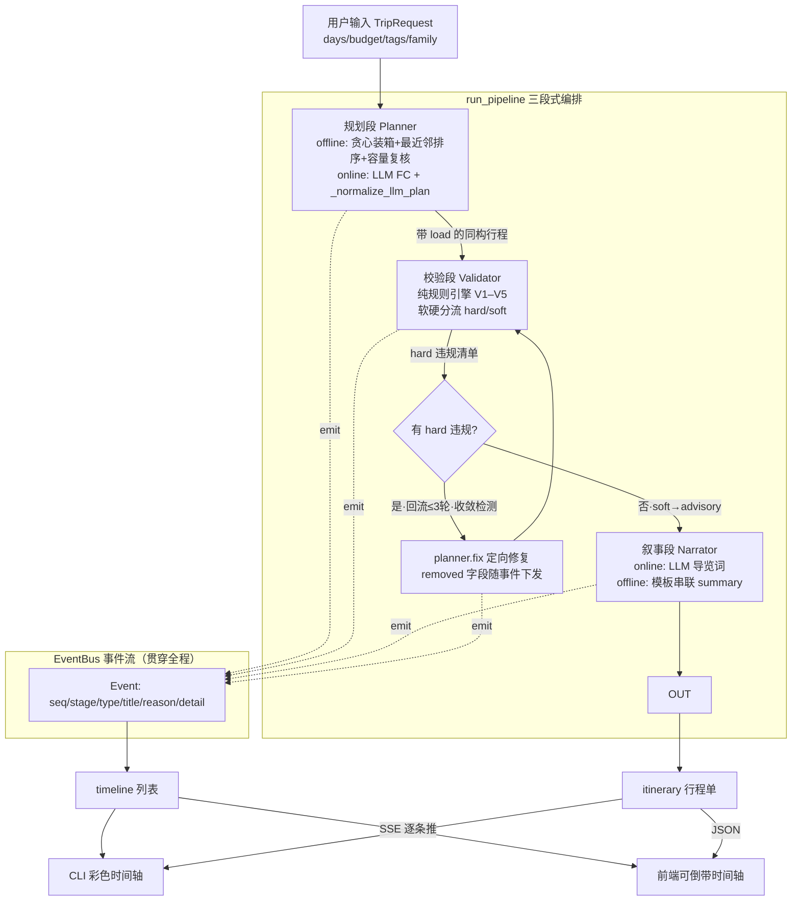
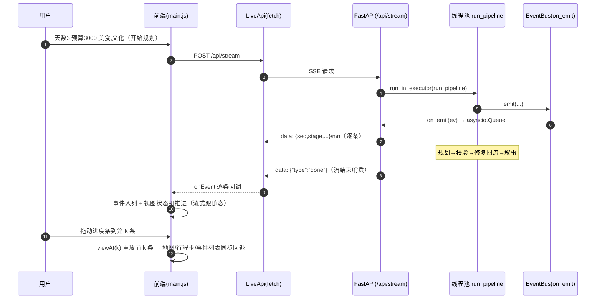

# 架构设计

> 三段式管线 + 事件流一等公民。本文每一节都对照代码可验证。

## 一、三段式管线（mermaid）



## 二、ASCII 版（纯文本环境）

```
                    ┌────────────────────────────────────────────┐
 TripRequest ──────►│ run_pipeline（server/agent/pipeline.py）    │
 days/budget/       │                                            │
 tags/family        │  ┌─────────┐   ┌───────────┐   ┌────────┐ │
                    │  │ Planner │──►│ Validator │──►│Narrator│ │
                    │  │ 规划段  │   │ 校验段     │   │ 叙事段 │ │
                    │  │         │◄──┤ 规则引擎   │   │        │ │
                    │  │贪心装箱  │fix│ V1..V5    │   │LLM/模板│ │
                    │  │LLM FC   │   │ (零LLM)   │   │        │ │
                    │  └────┬────┘   └─────┬─────┘   └───┬────┘ │
                    │       │  回流≤3轮     │             │      │
                    └───────┼───────────────┼─────────────┼──────┘
                            │ emit          │ emit        │ emit
                            ▼               ▼             ▼
                    ┌────────────────────────────────────────────┐
                    │ EventBus（server/agent/events.py）          │
                    │ Event{seq,stage,type,title,reason,detail}  │
                    │ 实例级 seq · on_emit 回调（SSE 推流）       │
                    └───────────────────┬────────────────────────┘
                                        │ timeline()
             ┌──────────────────────────┼──────────────────────────┐
             ▼                          ▼                          ▼
     CLI 彩色时间轴            FastAPI /api/stream          前端可倒带时间轴
     (cli.py TYPE_MARK)       (SSE data: 帧+done哨兵)      (player.js seek 语义)
```

## 三、事件流时序（用户输入 → 管线 → EventBus → SSE → 前端回放）



## 四、模块职责与关键设计决策

### server/agent/（管线层）

| 模块 | 职责 |
|---|---|
| `pipeline.py` | 三段编排 + 软硬分流 + 收敛检测；`on_event` 回调不改 emit 签名 |
| `planner.py` | 贪心装箱 / 最近邻排序 / 容量复核摘点 / LLM FC + 归一化 / fix 定向修复 |
| `validator.py` | 纯规则引擎（规格见 `规则引擎规格.md`），零 LLM 依赖 |
| `narrator.py` | 每日导览词：LLM 在线 / 模板兜底（夜景收尾句与排班一致性校验） |
| `revise.py` | 对话式改行程：规则意图解析（第N天/四类动作/POI 模糊匹配）→ 只重排目标天 |
| `events.py` | EventBus：实例级 seq、on_emit 回调（SSE 数据源） |
| `llm.py` | DeepSeek FC 客户端 + `SD_LLM_MODE` 三态开关（auto/offline/online） |

### server/tools/（工具层）与 server/cloud/（华为云层）

poi_search（打分可解释）/ route（haversine+道路系数）/ weather（本地快照+FG 可选）/
budget（门票餐饮交通）/ geo（Projector 分城投影）。cloud 层见 `华为云接入说明.md`。

### 为什么本地快照（40 点厚字段）

答辩现场网络不可控，断网完整演示是保命需求；字段做厚（开放时段/预约/爬坡/亲子）
让每个决策有真实可解释依据。**数据层 v2 已把「可对接 OTA」从话术变成结构**：
分城快照 + meta.json，新增城市零代码改动（见 `server/data/schema.md`）。

### 为什么规则引擎做校验（而不是让 LLM 自查）

规则可枚举（V1–V5）、可单测（每条都有用例）、可解释（detail 直接给人看）。
LLM 规划的幻觉风险由确定性规则兜住；违规回流修复最多 3 轮防死循环，
轮满残留则如实标注——诚实工程，不装完美。

### 为什么事件流是一等公民

差异化竞争力「可倒带时间轴」要求数据层先行：每个决策带 `reason`，
前端才能回放「为什么第二天排这三个点」。事件从 CLI 第一天就是结构化产出，
SSE 只是序列化同一事件流——数据结构决定动效上限。

### 为什么软硬分级

强度超标没有唯一正确的删点解（南山一棵树是必游夜景机位，磁器口是核心景点），
「删点凑阈值」是糟糕的产品决策。软约束发 advisory 提醒、不占硬违规名额、不进修复循环——
系统如实提示，把决策权交还用户。

## 五、前端五个模块（零构建，static/js/）

```
api.js（★ 契约层）
  ├─ LiveApi   health 2s 内 200 → fetch + SSE 手工解析 data: 帧
  ├─ MockApi   超时/非200 → demo*.json 本地回放（stream 用 setTimeout 350ms 逐条推，同构收尾）
  └─ pick()    懒选择；上层只见 api 六方法，无任何 if(mock) 分支

main.js（装配与状态）
  ├─ 视图状态机 viewAt(cursor)：回放第 k 条 = 依序 apply 前 k 条事件
  │    decision→地图点亮 / violation·advisory→标记 / fix(removed)→灰叉 / narrate done→导览词
  ├─ run()/revise() 可见兜底（错误上徽标红字，不白屏）
  └─ 底部抽屉开关（按钮/关闭钮/Esc/遮罩）

map.js（双城 SVG）      分城投影坐标直接消费 demo-geo.json；removed 灰叉；--i stagger
timeline.js（行程区）   Tab 切天 / 三类条目 / removedNames 删除线 / advisory 琥珀条
player.js（回放器）     进度条 seek(k) 语义 / 单步 / 倍速 / 搜索过滤 / cur 焦点
```

数据流：`api → main(state) → {map, timeline, player}` 单向；播放器 seek 是唯一的视图时间源。